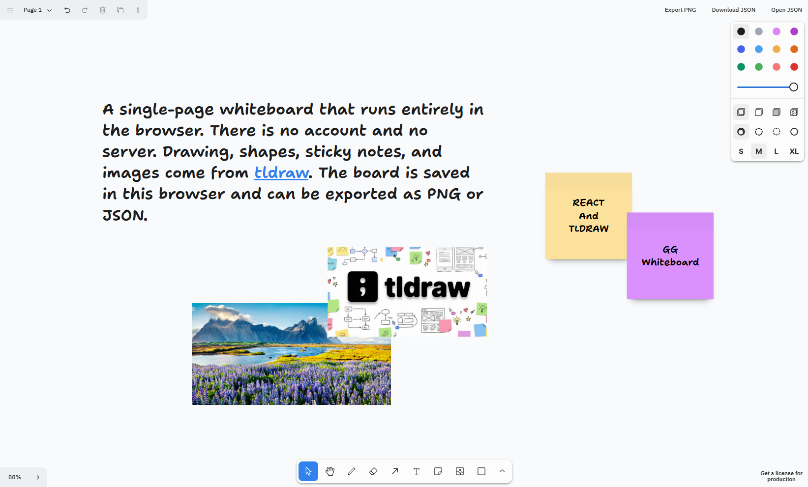

# GG Whiteboard

A single-page whiteboard that runs entirely in the browser. There is no account and no server. Drawing, shapes, sticky notes, and images come from [tldraw](https://tldraw.dev). The board is saved in this browser and can be exported as PNG or JSON.



## Features

- Infinite canvas with pen, highlighter, eraser, shapes, arrows, text, frames, and sticky notes
- Select, move, resize, undo, redo, pan, and zoom
- Paste or drop images onto the board
- Local save in the browser, including across tabs, under the key `gg-whiteboard`
- **Export PNG** downloads the current page
- **Download JSON** saves the board as `whiteboard.json`
- **Open JSON** loads a snapshot back onto the board, and asks before replacing a page that already has shapes

A refresh keeps the board. Clearing the site data for this origin removes it.

## React and tldraw

The UI is a React 19 app written in TypeScript and bundled with Vite. `src/main.tsx` mounts `<App />` with `createRoot` inside `StrictMode`. `App` only renders the whiteboard. React is the shell. It does not implement drawing, hit testing, or the tool state machine.

The canvas is the [`Tldraw`](https://tldraw.dev/quick-start) component from the `tldraw` package. Mounting it full screen, and importing `tldraw/tldraw.css`, gives the infinite canvas, the toolbar, menus, undo history, and image paste. Those tools stay on tldraw's side. This project does not redraw them.

```tsx
<div className="whiteboard">
  <Tldraw components={components} persistenceKey="gg-whiteboard" />
</div>
```

Two props connect the React app to the editor:

- `persistenceKey` names the document. tldraw writes shapes and image assets to IndexedDB under that key and restores them on the next load. The same key also keeps other tabs of this origin in sync.
- `components` replaces pieces of tldraw's own UI. `SharePanel` is set to `ExportPanel`, a React component defined in this repo. The object lives outside the component so React does not pass a new override on every render. tldraw requires that.

`ExportPanel` is rendered by tldraw, inside its React tree, so it can call `useEditor()` from `@tldraw/editor`. That hook returns the live editor for the board on screen:

- **Export PNG** reads the current page with `editor.getCurrentPageShapeIds()` and renders those shapes with `editor.toImage()`. An empty page shows a toast from `useToasts()` instead of downloading a file.
- **Download JSON** calls `getSnapshot(editor.store)`. The snapshot has two parts: `document` (pages, shapes, assets) and `session` (camera, current page, selection).
- **Open JSON** parses a file and calls `loadSnapshot(editor.store, snapshot)`, which replaces the document in the store. If the page already has shapes, the panel asks first.

The buttons are `TldrawUiButton`, so they use the same styling as the rest of the editor. The panel sits in tldraw's share slot, in the top-right, and does not add a second toolbar.

## Requirements

- Node.js 22 or newer
- npm

## Run locally

```bash
npm install
npm run dev
```

Open http://localhost:5173.

| Script | What it does |
| --- | --- |
| `npm run dev` | Start the dev server |
| `npm run build` | Typecheck and build for production |
| `npm run preview` | Serve the production build |
| `npm run lint` | Run Oxlint |

## Project layout

```
src/
  App.tsx                      mounts the whiteboard
  whiteboard/Whiteboard.tsx    full-screen tldraw editor
  whiteboard/ExportPanel.tsx   PNG and JSON actions
```

## Production

Local development does not need a tldraw license key. A deployment served over HTTPS on a public host does. Without a valid key the editor stops rendering after a few seconds. See the [tldraw license](https://tldraw.dev/community/license).

## License

This app is a small shell around the tldraw SDK. The SDK is source-available under the [tldraw license](https://github.com/tldraw/tldraw/blob/main/LICENSE.md), which allows development use and requires a separate license for production.
